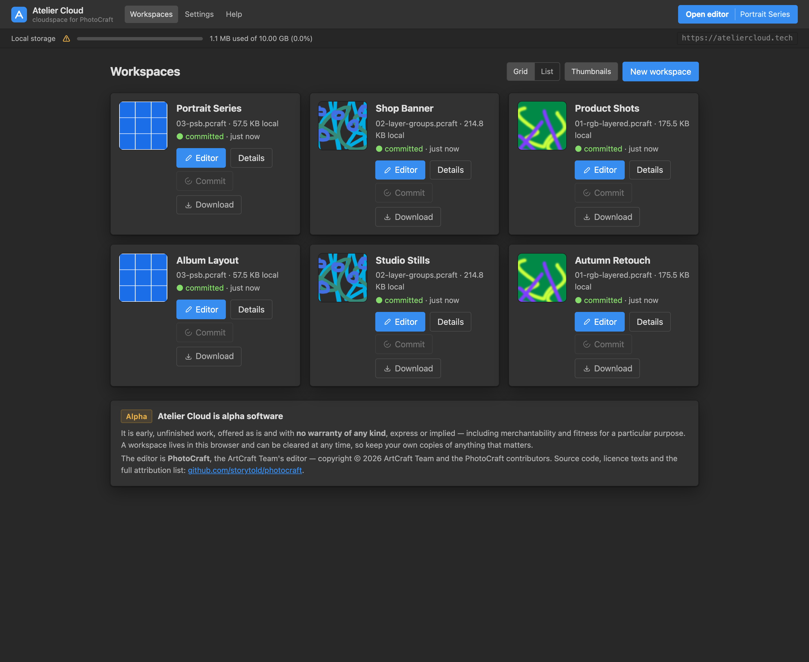

<div align="center">

# Atelier Cloud

**A cloudspace for the [PhotoCraft](https://github.com/storytold/photocraft) editor. Workspaces live in your
browser's own storage, and the documents you care about go to a bucket that is yours.**

[](#status)
[](LICENSE)
[](server)
[](web)
[](https://github.com/storytold/photocraft)



</div>

Atelier Cloud is the **cloudspace provider** around the PhotoCraft editor. It uses the Origin Private File
System (OPFS) that a workspace lives in, the launcher that makes and opens workspaces, the Changes → commit →
outbox flow, and the upload and download of a document to an S3-compatible bucket. The editor is upstream
and unmodified, bar a small patch this repository applies to it from source ([`hook/`](hook)).

Both halves live here, and both are reached through **one process on one origin**:

| | What | Where |
| --- | --- | --- |
| **Atelier web** | the server: health, capabilities, the cloud app, and the editor proxy | [`server/`](server) — Rust, axum |
| **Atelier Cloud** | the app: workspace grid, workspace detail, settings, help | [`web/`](web) — SvelteKit, static, launcher and prose pages prerendered |

> [!WARNING]
> **Atelier Cloud is alpha software.** It is early, unfinished work, offered as is and with no warranty of
> any kind, express or implied. A workspace lives in this browser and can be cleared at any time, so keep
> your own copies of anything that matters.

## Contents

- [Status](#status)
- [Features](#features)
- [Quick start](#quick-start)
- [Workspaces](#workspaces)
- [Buckets](#buckets)
- [How it works](#how-it-works)
- [Configuration](#configuration)
- [Docker](#docker)
- [End-to-end with a patched editor](#end-to-end-with-a-patched-editor)
- [Testing](#testing)
- [Samples](#samples)
- [Project layout](#project-layout)

## Status

**Atelier Cloud is early, but the whole loop works.** A workspace can be created, opened in the editor,
edited, saved back into OPFS, and seen in the Changes panel as an exact object diff. A workspace can also be
given a bucket of its own, and its document uploaded to and downloaded from the browser.

There are still no accounts and no server-side revisions, and the only thing that ever holds a bucket
credential is the browser it was given to.

## Features

**Workspaces, in storage the browser owns**

- Workspaces live in OPFS, under `atelier-cloud/`, so they survive a reload, a second tab and an evicted
  cache — and they never leave the machine unless you put them in a bucket.
- Make one from a bundled sample, from a `.pcraft` on your disk, from a document a bucket already holds, or
  empty.
- Grid and list layouts, thumbnails, sizes, and when each workspace last changed.
- The landing page reports storage health: what this origin uses, whether it is persistent, and which origin
  it is — because one origin is what makes both apps share one OPFS.

**An exact diff, not a guess**

- The Changes panel reads the `.pcraft` central directory — a STORE-mode ZIP whose entry names are BLAKE3
  hashes — and reports the delta as a set difference over entry names. Object counts and byte sums are real,
  with no decompression and no upload.
- *Record version* commits, *Discard* returns the document to the previous bytes, *Download* hands you the
  raw `.pcraft`.

**The editor, on the same origin**

- *Open* navigates to the patched editor with the workspace loaded; `File ▸ Save` writes back into OPFS.
- The editor's title bar carries a *Back to Atelier Cloud* link, after its other controls.

**A bucket per workspace, with no secret on the server**

- Attach an S3-compatible bucket to one workspace: endpoint, bucket, region, key prefix and an access key
  pair, either while making the workspace or later on its page.
- Upload, download, list and load documents. The browser signs its own requests and sends its own bytes, so
  no document ever passes through the server and no credential is ever stored by it.

## Quick start

### Requirements

| | For | Needed |
| --- | --- | --- |
| Rust (stable) | the server | always |
| Node 22+ and npm | the cloud app | always |
| Docker or Colima | a prebuilt editor container | optional |
| `trunk`, the `wasm32-unknown-unknown` target, `python3` | the patched editor, for the end-to-end flow | optional |

### Run it

Build the cloud app once:

```sh
cd web && npm install && npm run build && cd ..
```

Then give it an editor, from a checkout of [PhotoCraft](https://github.com/storytold/photocraft) cloned
beside this repository:

```sh
cd ..
git clone https://github.com/storytold/photocraft
cd photocraft
docker build --load -t photocraft-web:local .
docker run -d --name photocraft-web --restart unless-stopped -p 8080:8080 photocraft-web:local
cd ../atelier_web         # back to this checkout
```

Now start Atelier web:

```sh
./run.sh                 # then open http://127.0.0.1:3000/cloud/
```

`run.sh` starts the editor container if it is stopped, waits for the editor to answer, then runs Atelier web
in the foreground. Ctrl-C stops Atelier web; the container keeps running. It says what to build when
something is missing, so running it cold is safe.

> [!NOTE]
> That container holds an **unpatched** editor: it opens and edits files from your own disk, and it cannot
> open a workspace, because the patch is what tells the editor a cloudspace exists. `File ▸ Open` there is
> the local file picker, as it always was. [End-to-end with a patched
> editor](#end-to-end-with-a-patched-editor) is how the whole flow is reached.

If you serve the editor yourself instead — `trunk serve --port 8765` in that checkout, or a patched build —
point Atelier web at it:

```sh
PHOTOCRAFT_UPSTREAM=http://127.0.0.1:8765 ./run.sh
```

Neither path needs a bucket, and neither is configured with one: a bucket belongs to a *workspace* and is
attached with the user's own credential ([Buckets](#buckets)).

### What you should see

| URL | What |
| --- | --- |
| <http://127.0.0.1:3000/cloud/> | Atelier Cloud: the workspace grid and storage health |
| <http://127.0.0.1:3000/cloud/workspace/&lt;id&gt; | one workspace: Changes, commit, download, discard, and the bucket |
| <http://127.0.0.1:3000/cloud/settings> | storage, persistence, and what the cloudspace holds |
| <http://127.0.0.1:3000/cloud/help> | where the work lives, then FAQ and troubleshooting: bucket setup, CORS, and the errors that read like credentials |
| <http://127.0.0.1:3000/> | PhotoCraft; launched into a workspace, its title bar links back to it |
| <http://127.0.0.1:3000/api/health> | `{"service":"atelier-web","status":"ok","hello":"world"}` |

`/cloud/`, `/cloud/settings` and `/cloud/help` are prerendered at build time, so the HTML a client
receives already holds the page: its title, description, headings and copy. A workspace id is not known
at build time, so `/cloud/workspace/<id>` is rendered by the client from `200.html`. No server rendering
is involved either way, which is why all four work with no server behind them.

### One origin, or the two apps cannot see each other

> [!IMPORTANT]
> Reach everything through **:3000**. OPFS is keyed by *origin* (`scheme://host:port`), so
> <http://127.0.0.1:8080/> is a different origin with a different, empty OPFS: the two apps cannot see each
> other's data, and nothing reports an error. Atelier web exists precisely to prevent this.

With no editor at all, `/cloud/` still works, and `/` returns a 503 page that says how to start one.

## Workspaces

**Making one.** The landing page offers a bundled document, an empty workspace, a `.pcraft` from your
computer, or — with a bucket's fields filled in — a document that bucket already holds. A first workspace
needs a document and a browser cannot convert a PSD, so three `.pcraft` documents are committed under
[`web/static/samples/`](web/static/samples); they are generated from [`file_samples/`](file_samples) with the
editor's own headless CLI ([Samples](#samples)):

```sh
cd file_samples && ./to-pcraft.sh          # needs ../photocraft/target/release/photocraft-cli
```

**Opening one.** *Open* navigates to `/?project=<id>`. The patched editor reads `provider.json`, finds the
project's single `*.pcraft`, takes the shared Web Lock, and hands the bytes to its own import path. Saving in
that session writes back to `atelier-cloud://<id>/<name>.pcraft`, which the patch turns into a write into
OPFS, keeping the previous bytes beside the document.

The nav's *Open editor* action carries the same `?project=<id>`, for the workspace that changed most
recently, so it lands in the editor with something to show. It opens a new tab, like the card's *Editor* and
the workspace page's *Open in editor*: the launcher survives the trip, and the provider's unload guard is
never asked to warn about a navigation that puts nothing at risk. With no workspace yet the action reads *In
new workspace* and opens the new-workspace dialog instead. Opening `:3000/` without a project is the bare
editor: no document, no link.

## Buckets

A workspace can be given a bucket of its own — an S3-compatible one, with an access key pair you supply — and
its document uploaded to and downloaded from it by the browser. The *Bucket* panel on the workspace page
takes an endpoint, a bucket, a region, a key prefix and an access key pair, and the dialog that makes a
workspace takes the same fields, so a workspace can be made with a bucket rather than opened and given one.
The document is written as `<prefix><project>/<document>`.

Two things are worth knowing before you attach one:

- **The credential stays in that browser.** The server never stores it, and every request is signed by the
  browser that was given it.
- **The bucket has to allow this origin**, or the upload fails with an opaque error that reads like bad
  credentials.

[`docs/buckets.md`](docs/buckets.md) is the reference: what the panel writes, what one upload does, how
*Download* and *Choose from bucket…* behave, where the key lives, and the CORS policy to paste into R2.

## How it works

[`server/`](server) is **Atelier web**: one small [axum](https://github.com/tokio-rs/axum) process that both
apps are reached through, on one port. It is the reason they share an origin — and therefore one OPFS — and
it holds no credential of any kind. It serves:

- `/api/health` — the hello-world JSON endpoint.
- `/cloud/…` — the built SvelteKit app: the prerendered launcher, settings and help, and `200.html` for
  `/cloud/workspace/<id>`. Any other path is a 404, so an invented URL is not an indexable copy of the app.
  Hashed files under `_app/` are cached for a year; everything else revalidates.
- `/robots.txt` and `/sitemap.xml` — built from the request's own `Host`, so a second deployment advertises
  itself. Workspaces are disallowed and settings is left out of the sitemap.
- everything else, reverse-proxied to `PHOTOCRAFT_UPSTREAM`, so the editor is on our origin.

Requests and responses are forwarded with hop-by-hop headers stripped and `Host` re-derived, so the editor's
`application/wasm` MIME type and its precompressed gzip assets keep working untouched.

The cloud app talks to OPFS, to this origin's own files, and — only when asked — to the bucket.
[`../docs/atelier_design.md`](../docs/atelier_design.md) has the detail: what lives where, which side writes
which file, the lock names, and which messages are advisory only. The short version:

| Side | Owns |
| --- | --- |
| Atelier Cloud | everything under `atelier-cloud/` except the document: `provider.json`, the catalog, `meta.json`, `bucket.json`, `thumb.png`, `outbox/` |
| The editor patch | `projects/<id>/<name>.pcraft` and its `.prev`, and nothing else |

[`web/src/lib/contract.ts`](web/src/lib/contract.ts) is the provider's side of that, and
[`web/src/lib/pcraft.ts`](web/src/lib/pcraft.ts) reads a `.pcraft`'s central directory. That is what makes
the Changes panel exact.

## Configuration

| Variable | Default | Meaning |
| --- | --- | --- |
| `ATELIER_PORT` | `3000` | Port Atelier web listens on. |
| `ATELIER_BIND` | `127.0.0.1` | Address to bind. Loopback by default; a container sets `0.0.0.0`. |
| `PHOTOCRAFT_UPSTREAM` | `http://127.0.0.1:8080` | Where the editor is served from. |
| `ATELIER_WEB_DIR` | `web/build` | Directory served at `/cloud/`. |
| `ATELIER_PROFILE` | `standalone` | `standalone`, or `hosted` to put a service behind identity and storage. `self-hosted` is accepted for the first. |
| `ATELIER_CENTRAL_URL` | — | That service's public base URL. Required by `hosted`, ignored otherwise. |

`hosted` is a seam for a service that does not exist in this repository: the default runs everything
itself and needs no configuration at all.
A profile that cannot be configured stops the process rather than serving a half-configured deployment: an
unknown `ATELIER_PROFILE`, or `hosted` without `ATELIER_CENTRAL_URL`, prints what is wrong and exits `2`.

There is no bucket configuration here, and none in the repository at all — a bucket is attached in the
browser, to one workspace.

Plain `http://` upstreams only: the proxy is built without TLS support to keep the first build quick (see
[`server/Cargo.toml`](server/Cargo.toml)). Everything runs on loopback, so that is fine; add `rustls-tls` to
`reqwest` if you ever need an `https://` upstream. The bucket is a different connection entirely — the
browser speaks HTTPS to it, and this process is not in the path.

## Docker

The [`Dockerfile`](Dockerfile) builds the server and the cloud app into one small image. It does **not**
contain the editor: that is upstream, patched at build time
([below](#end-to-end-with-a-patched-editor)), and this image proxies to wherever it runs.

```sh
docker build -t atelier-web .
docker run --rm -p 3000:3000 \
  -e PHOTOCRAFT_UPSTREAM=http://host.docker.internal:8080 atelier-web
```

Two values the image sets that the development defaults do not: `ATELIER_BIND=0.0.0.0`, because a container
has no loopback to share with its host, and `PHOTOCRAFT_UPSTREAM=http://editor:8080`, which you override to
reach your editor.

There is no compose file, because the editor is a separate project with its own image and wiring the two
together is a deployment decision. Whatever sits in front of this has to keep both apps on **one origin**, or
they will not share an OPFS ([the trap](#one-origin-or-the-two-apps-cannot-see-each-other)).

## End-to-end with a patched editor

To exercise the cloud flow, build the editor from the pinned commit with the patch applied and point Atelier
web at it:

```sh
cd ../photocraft
git worktree add --detach /tmp/photocraft-hook 8407d9ccb125af52944fca9d228383459f94aaef
cd ../atelier_web
CARGO_TARGET_DIR=../photocraft/target PHOTOCRAFT_DIR=/tmp/photocraft-hook ./hook/apply.sh build
cd /tmp/photocraft-hook/dist/web && python3 -m http.server 8765
cd - && PHOTOCRAFT_UPSTREAM=http://127.0.0.1:8765 ./run.sh
```

Keep the worktree out of your `../photocraft` checkout: it is upstream, and it stays pristine.
[`hook/README.md`](hook/README.md) has the details, including how to re-apply once upstream moves.

## Testing

```sh
cd server && cargo test && cargo clippy --all-targets -- -D warnings
cd web && npm ci && npm run check && npm run format:check && npm run build
```

The cloud app is formatted rather than hand-wrapped: Prettier with `prettier-plugin-svelte`, on Prettier's
own defaults, and `npm run format:check` is the same thing as a test. Elsewhere — the Rust, the walkthroughs
in `test/` — match the style of the file you are editing. `cargo fmt` is deliberately not part of the check
list: the Rust is not rustfmt-formatted, and reformatting it would bury real changes.

The end-to-end walkthroughs need a browser and a running server, and are the only way to check the OPFS
handoff:

```sh
cd test && npm ci && npm run walkthrough   # create, open, edit, save, commit
cd test && npm run attach                  # the bucket flow, against a local S3 stand-in
```

`npm run attach` needs no bucket, no account and no credentials. The stub is started with credentials that
exist nowhere else — not in an environment, not in a file — so a signature it accepts is proof that the
*browser* signed with the credential the form was given. It asserts the round trip byte for byte, that
`meta.json` records the bucket's ETag, that the attachment survives a reload without re-entering the secret,
that what is stored is a non-extractable `CryptoKey` and not the secret, and that the page never asks the
server about a bucket:

```sh
# terminal 1: Atelier web, with no bucket settings at all
cd server && cargo run --release

# terminal 2
cd test && npm install && npm run attach
```

Against a real bucket the panel itself is the test, and [the CORS
policy](docs/buckets.md#cors-on-the-bucket) is what the browser needs.

**The editor patch is a first-class artifact**, and [`.github/workflows/patch.yml`](.github/workflows/patch.yml)
proves it still applies (3-way, and reverts), still builds, and still fits inside its documented footprint
and the 25 MiB wasm budget that Cloudflare enforces. Its second job checks the patch against upstream `main`
and is allowed to fail: drift from upstream should be a red build, not a surprise.

## Samples

[`file_samples/`](file_samples) holds three documents, so there is something to open before anything has been
imported. Each covers a different code path, and all three load with the editor's own importer:

| File | What it exercises |
| --- | --- |
| `01-rgb-layered.psd` | the common case: 300×200 RGB, 8-bit, 3 pixel layers |
| `02-layer-groups.psd` | layer structure: 300×200 RGB, 8-bit, one group |
| `03-psb.psb` | the PSB (version 2) reader: 413×413 RGB, 8-bit |

`to-pcraft.sh` converts them into the `.pcraft` documents under
[`web/static/samples/`](web/static/samples), which are what a new workspace starts from. Inspect any of them
from the terminal:

```sh
../photocraft/target/release/photocraft-cli info file_samples/02-layer-groups.psd --compact
```

The samples come from [ag-psd](https://github.com/Agamnentzar/ag-psd) (MIT; licence alongside). That project
and [psd-tools](https://github.com/psd-tools/psd-tools) also back the editor's own pinned corpus — 170 files
covering every colour mode, depth, blend mode and adjustment, plus masks, text, vectors, smart objects and
artboards:

```sh
cd ../photocraft && cargo xtask corpus --psd    # → corpus/psd/
```

## Project layout

```
atelier_web/
├── README.md          this file
├── LICENSE, NOTICE    MIT, and the third-party material
├── CONTRIBUTING.md    how to run it, check it, and keep the patch in shape
├── Dockerfile         the server and the cloud app in one image (no editor)
├── docs/              buckets.md, the bucket reference, and the screenshot the README shows
├── run.sh             start both apps together
├── .github/workflows/ patch.yml: applies, builds and weighs the editor patch against the pin
├── server/            Atelier web: one process, both apps, one origin
│   └── src/           main.rs, the one-origin server; profile.rs, which deployment this is
├── web/               Atelier Cloud: SvelteKit, static, three pages prerendered
│   ├── src/lib/       the OPFS contract, the .pcraft reader, the pages' shared state, the bucket,
│   │                  and what the deployment has to offer (capabilities.ts)
│   ├── src/routes/    /, /workspace/<id>, /settings, /help
│   ├── static/samples three converted documents to seed a workspace with
│   └── build/         what Atelier web serves (gitignored)
├── hook/              the only thing applied to photocraft: the patch, and apply.sh
├── test/              the browser walkthroughs, and a local S3 stand-in for the bucket one
└── file_samples/      the PSD/PSB originals, and to-pcraft.sh
```
