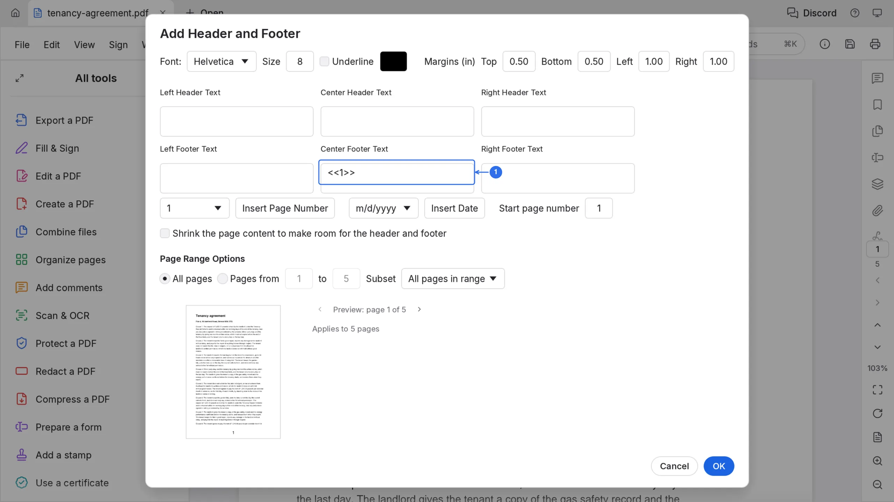
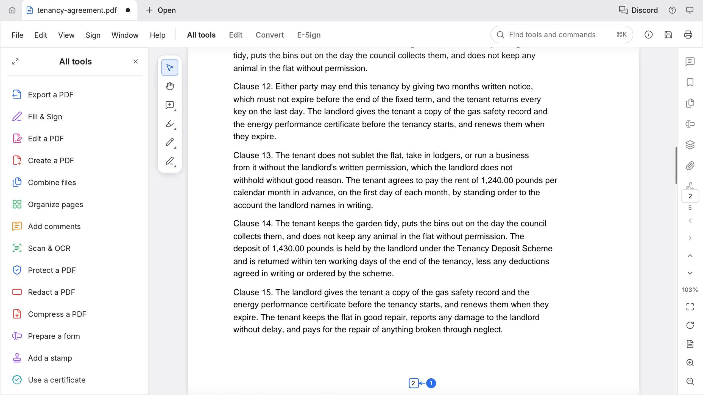
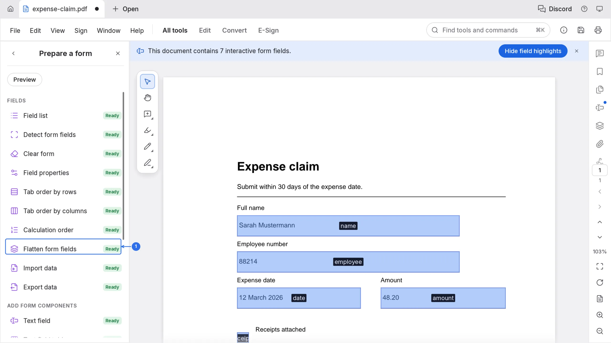
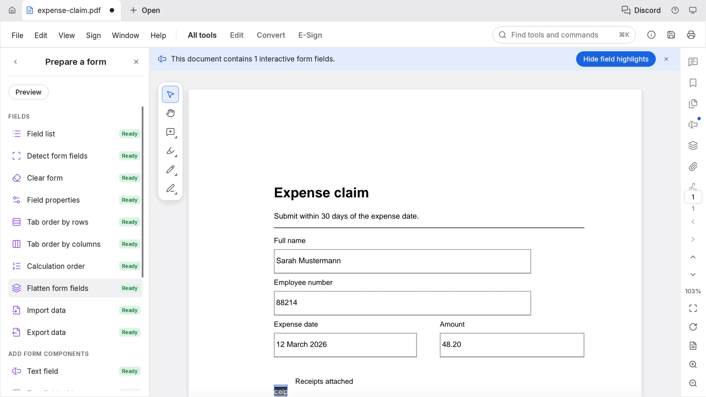

# Add page numbers to a PDF

A lease, a bundle of invoices, an evidence pack: someone will cite "page 4 of 12" and start counting by hand. PdfCraft draws the number into the footer of the page itself, so it prints and travels with the file instead of living in one reader's settings.

## Stamp the numbers

1. Choose **All tools** in the left sidebar, then **Edit a PDF**, then **Header and footer**, then **Add header & footer…**. Press ⌘K and type "footer" to reach the same command from the keyboard.
2. Click the box where the number belongs. **Center Footer Text** is the usual spot.
3. Choose a format from the list on the left of **Insert Page Number**: `1`, `1 of n`, `1/n`, `Page 1` or `Page 1 of n`. Then click **Insert Page Number**. The box holds a placeholder such as `<<1>>`, and the preview draws it where it will print.
4. **Start page number** sets what the first numbered page reads. To leave a cover page unnumbered, set **Pages from** 2 as well.
5. Leave **All pages** selected, or type a range beside **Pages from … to**.
6. Click **OK**.

## The result

Every page carries its number in the footer, so page 2 of the agreement reads 2. Because the number is page content, it survives printing, copying and re-saving, and a reader cannot switch it off.

## Flatten the form you filled in

Numbers on a form that somebody can still edit are half a job. Flattening turns the values into page content, so the next person sees what you typed and cannot change it.

1. Open the filled form. The claim from the fill and sign tutorial works.
2. Choose **All tools** ▸ **Prepare a form**.
3. Click **Flatten form fields**.

The blue field outlines go, together with the field-name labels the panel was showing, and the count in the banner above the page drops. What is left is a page that looks exactly like the one on screen.

Save with ⌘S, or the save icon in the top bar, to write both the numbers and the flattened fields back into the workspace.

## One-click alternative

**Action Wizard** carries a built-in action called **Add Page Numbers** that stamps `Page <<1>> of <<n>>` in the footer of every page. Use it when the default position and wording are what you want, and the dialog above when they are not.
