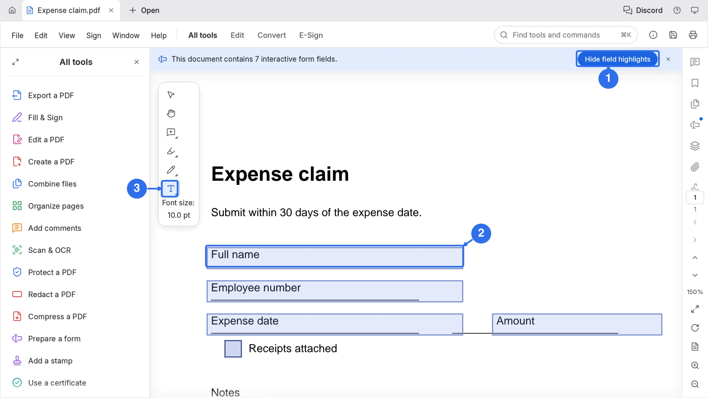
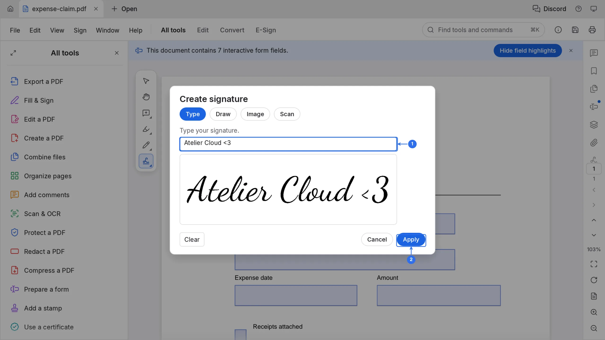
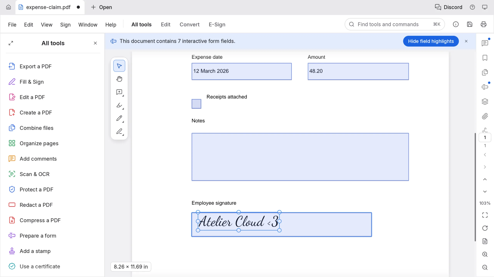

# Fill in and sign a PDF form

Many PDF forms have real, interactive fields, and PdfCraft fills them in place. You do not print the form, and you do not upload it to a form website either: the file stays in the browser until you save it.

## Fill the fields

1. Open the form. A banner above the page counts the fields, for example "This document contains 7 interactive form fields", and every field is outlined.
2. Click a field and type. Checkboxes, radio buttons and dropdown lists fill in where they stand.
3. Click **Hide field highlights** to see the page as it will print.
4. For text that is not one of the fields, choose **Fill & Sign** in the left sidebar and click **Add text**. The **T** tool appears in the toolbar with **Font size**; click the page and type.

## Add a signature

1. In **Fill & Sign**, click **Signature**.
2. The **Create signature** dialog offers four routes: **Type**, **Draw**, **Image** and **Scan**. **Type** writes what you type in a script face, as shown.
3. Click **Apply**, then click the page where the signature belongs. Drag a corner to resize it.
4. Use **Initials** for the short form. **Change signature** replaces a saved one.

## The result

Each field holds its value and the signature sits in the **Employee signature** box, still selected so you can drag a corner to resize it. The dot beside the file name in the tab means the document has changes you have not saved yet.

## Save

Save with the save icon in the top bar, or press ⌘S (Ctrl+S on Windows and Linux). In Atelier Cloud the file is written back into the workspace, so the next person who opens it sees the filled version.
