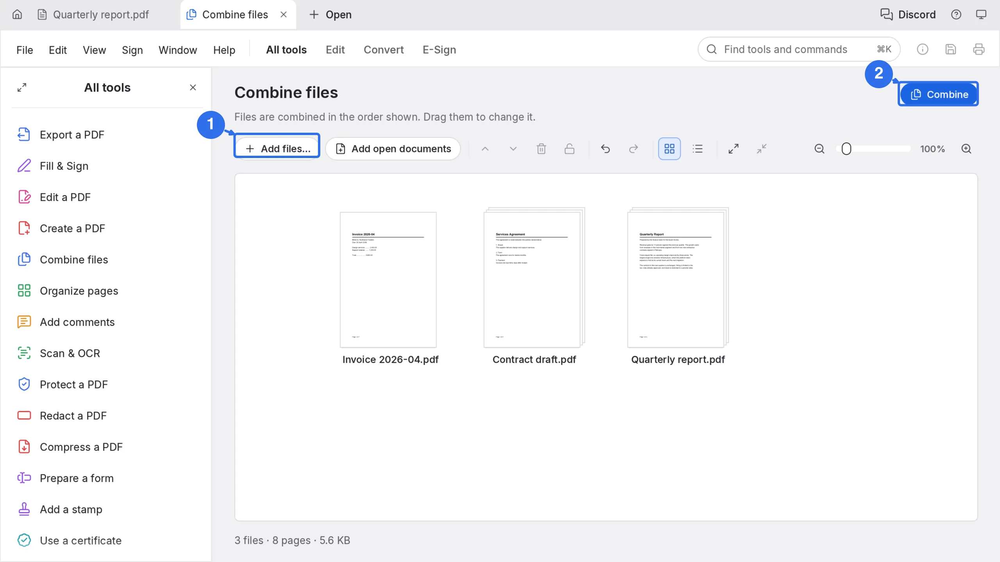
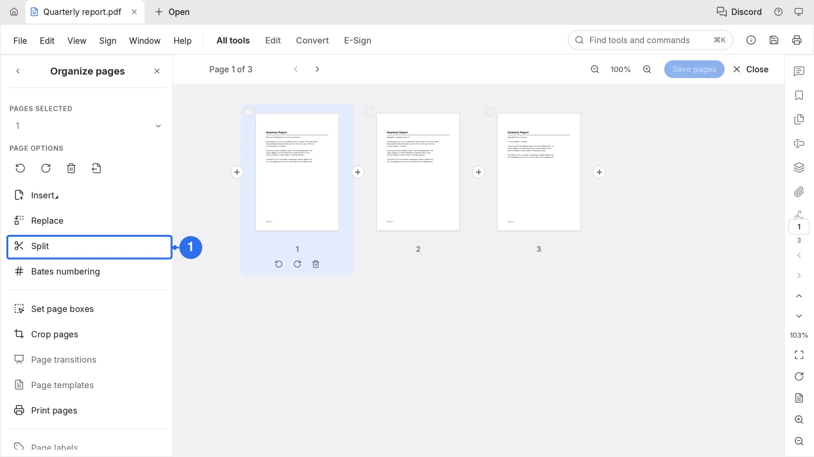
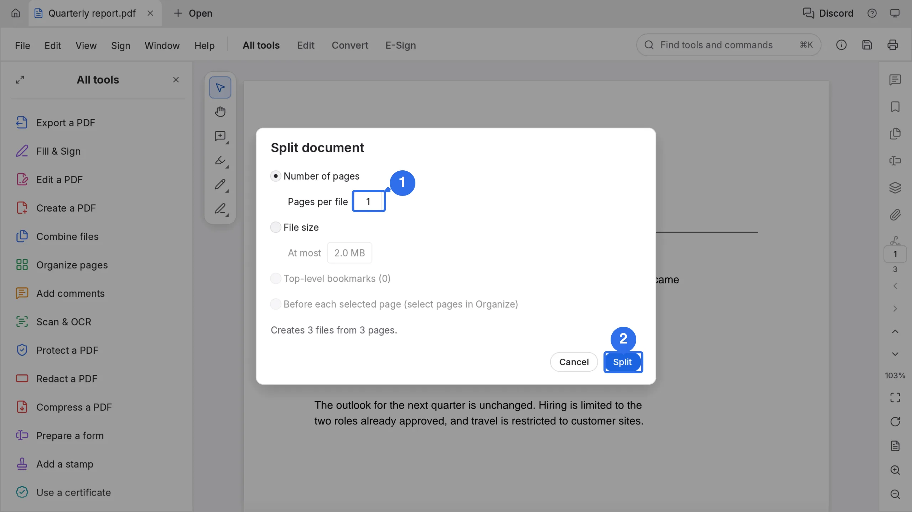
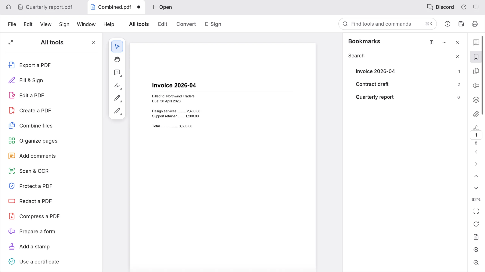

# Merge and split PDFs in the browser

You can join several PDFs into one file, or cut one PDF into parts, without installing a program and without uploading the documents. PdfCraft does both inside the browser tab, and every result is a normal PDF that opens anywhere.

## Merge files into one PDF

1. Open the PDF workbench and choose **All tools** in the left sidebar.
2. Click **Combine files**, then **Add files to combine**.
3. Click **Add files…** and pick the PDFs, or drop them onto the page. **Add open documents** adds files you already have open in other tabs.
4. Files are combined in the order shown. Drag a thumbnail to move it up or down.
5. Click **Combine** in the top right.

The result opens as a tab named `Combined.pdf`. Each source file becomes a bookmark, and its own bookmarks sit underneath it, so a long merge stays navigable.

## Split one PDF into parts

1. Open the document and choose **Organize pages** in the left sidebar.
2. Click **Split**.
3. In the **Split document** dialog, keep **Number of pages** selected and set **Pages per file**. The other rules are **File size**, **Top-level bookmarks** and **Before each selected page**.
4. Read the last line of the dialog. It states the outcome before anything is written, for example "Creates 3 files from 3 pages".
5. Click **Split**.

To take a few pages instead of cutting the whole file, select them in **Organize pages** and use **Extract** in **PAGE OPTIONS**. The selection becomes a new document and the original keeps its pages.

## The result

`Combined.pdf` opens as a new tab: 8 pages from the three files, and the bookmarks panel lists each part at the page it starts on. Merging keeps the pages it was given, so nothing is re-rendered and no text is re-encoded.

