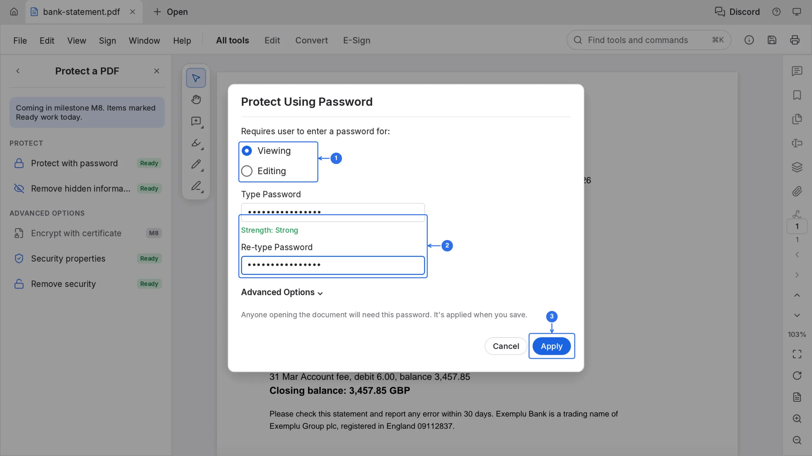
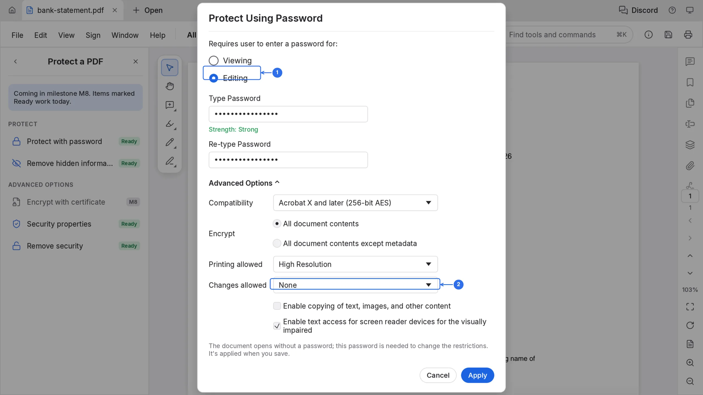
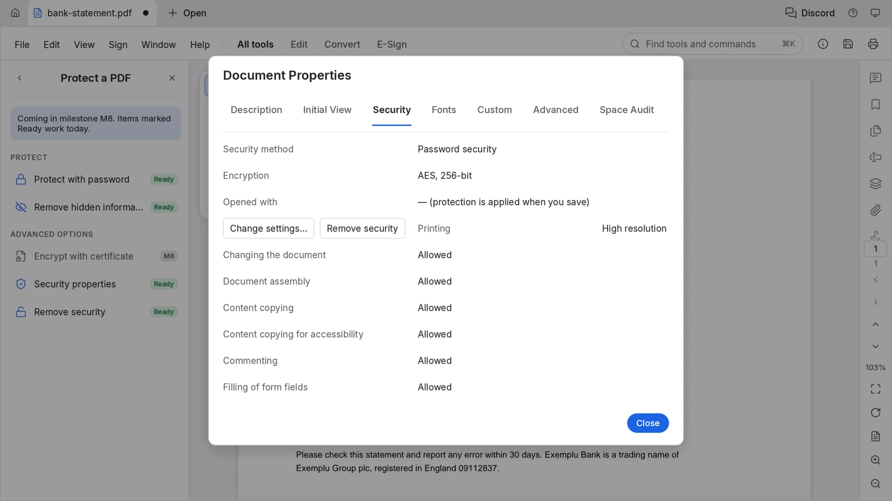

# Password protect a PDF

Most "protect PDF" sites want the file uploaded first. A bank statement is the last document to hand to a stranger's server. PdfCraft encrypts it in the browser tab, and saving writes the protected bytes back into the workspace, so the plain copy never leaves your machine.

The **Protect a PDF** panel carries a milestone banner; the password items in it are marked **Ready** and work today.

## Choose who needs the password

1. Choose **All tools** at the top of the left sidebar, then **Protect a PDF**.
2. Click **Protect with password**. The **Protect Using Password** dialog opens.
3. Pick what the password guards. **Viewing** means anyone who opens the file needs it. **Editing** means the file opens without a password, and the password is needed to change the restrictions.
4. Type the password in **Type Password** and again in **Re-type Password**. The **Strength** line under the first box reads Weak, Medium or Strong as you type, and **Apply** stays grey until both boxes match.
5. The line above the buttons says what will happen: anyone opening the document will need this password, and it is applied when you save.

## Restrict what a reader may do

This step matters when you chose **Editing**.

6. Click **Advanced Options**.
7. **Compatibility** picks the encryption. Acrobat X and later (256-bit AES) suits every current reader.
8. **Printing allowed** and **Changes allowed** decide what a reader may do without the password. **Changes allowed: None** locks the document against edits. The two check boxes below govern copying text and screen-reader access.

## Check it, then save

9. Click **Apply**. PdfCraft reports "Password protection will be applied when you save", and the tab keeps its unsaved dot.
10. Open **Security properties** to read what will be written. Press ⌘K, type "security properties" and press Enter; the **Security** tab of **Document Properties** shows **Password security**, **AES, 256-bit**, and **Opened with: — (protection is applied when you save)**.
11. Save with ⌘S, or the save icon in the top bar. Saving is the step that encrypts the file, and in Atelier Cloud it writes the encrypted version into the workspace.

## Changing or removing it

**Protect a PDF** ▸ **Remove security** asks for the password and strips the encryption on the next save. Run **Protect with password** on a file that already has one and PdfCraft asks for the current password first.
