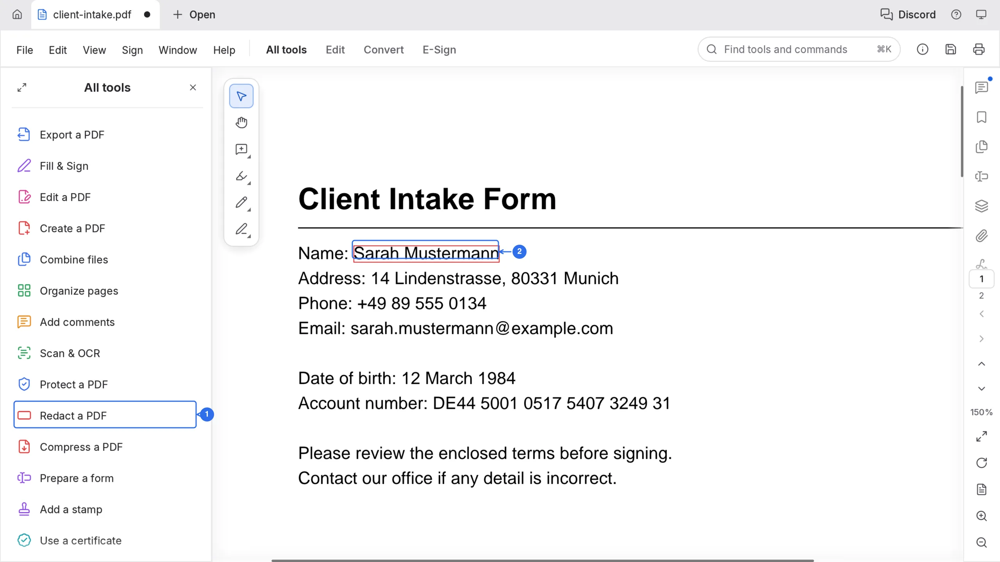
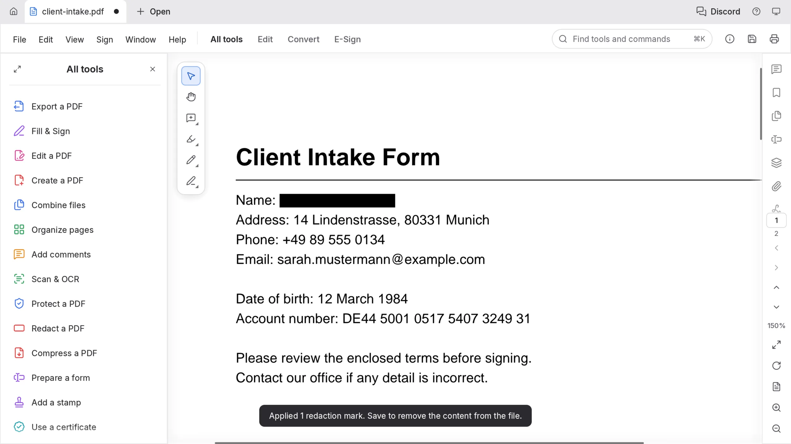

# Redact a PDF before you share it

Redaction websites usually ask you to upload the file you are trying to protect. PdfCraft marks and removes the content inside the browser tab, and saving rewrites the whole file, so the removed text is no longer inside it.

## Mark what must go

1. Open the document and choose **All tools** at the top of the left sidebar.
2. Find **Redact a PDF** and click **Redact text and images**.
3. Drag over each piece of text to cover, or click **Find text and redact** and type a name to mark every match at once. The panel footer counts the marks for you.
4. Click **Set properties** to change the **Redacted area fill colour**.

## Apply and save

5. Click **Redact all**. The **Apply redactions** dialog spells out what happens: text, images and drawings under the marks, and comments and form fields that overlap them, are removed permanently.
6. Click **Apply**.
7. Run **Sanitize document**. It removes metadata, attachments, comments, form fields, hidden text and layers, bookmarks, links, actions and scripts.
8. Save. Until you save, the document keeps its previous bytes, and saving is what rewrites the file.

## The result

`Name:` now ends in a solid bar. The text under it is gone from the file, not hidden behind a shape: the notice at the bottom says what is left to do, which is to save.

Two shortcuts are worth knowing. **Find text and redact** marks every match of a word at once, and **Redact pages** covers whole pages without drawing over them.
